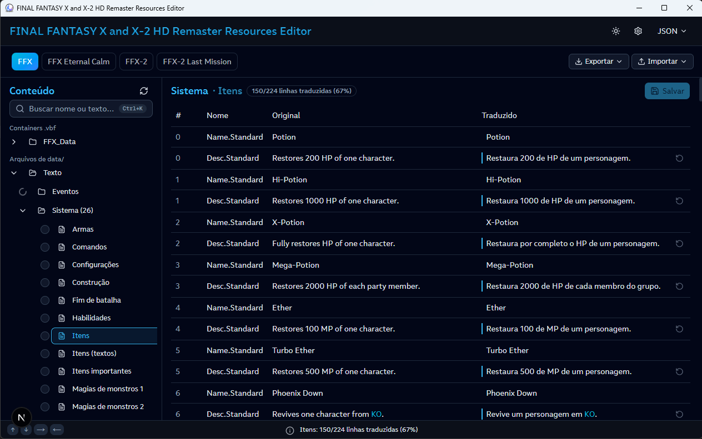
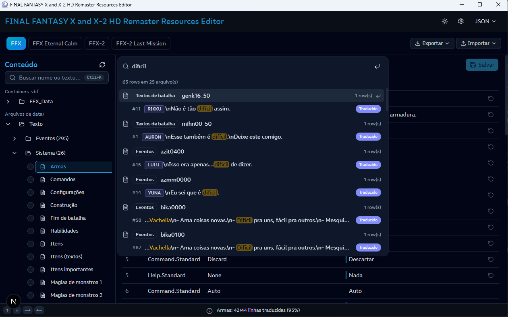
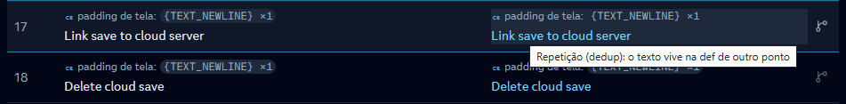
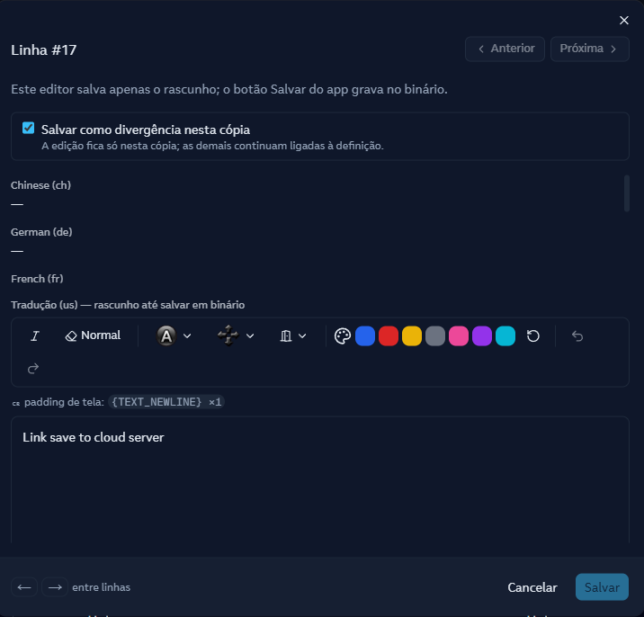
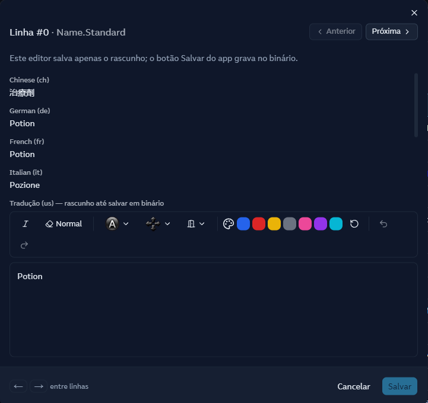
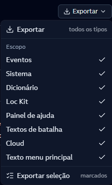
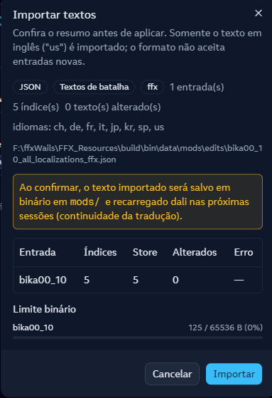
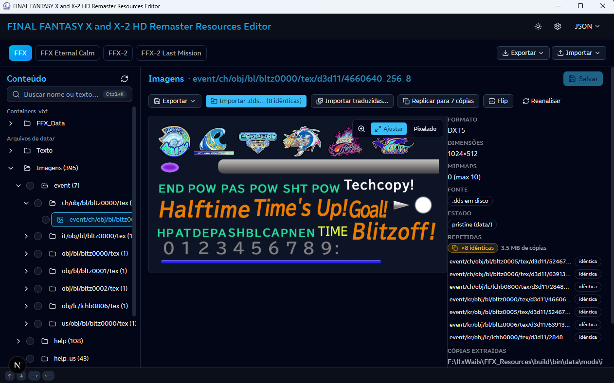
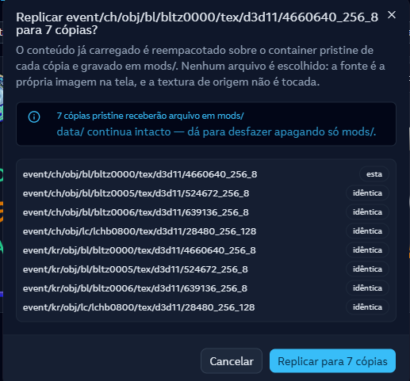
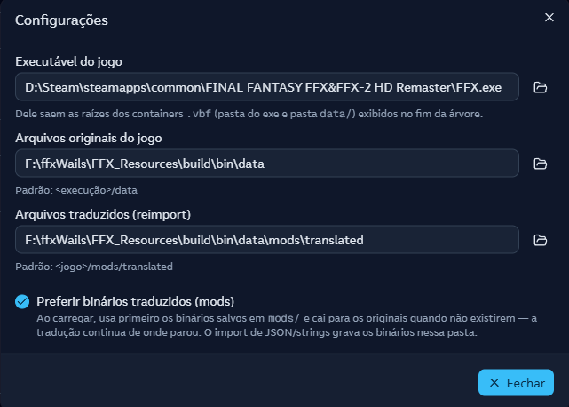

# Interface (frontend)

Como usar o editor: o que cada tela faz e onde as ações vivem. Não é um
guia de código — é o guia de **uso**.

A UI é um frontend Next.js/React (shadcn/ui + TipTap) renderizado em
WebView nativo pelo Wails v3, consumindo os bindings Go
(`frontend/bindings/ffxresources`): `TextService` (textos),
`ImageService` (texturas), `VbfService` (container), `ConfigService`
(configuração).



## Visão geral da tela

```
+--------------------------------------------------------------+
| AppHeader: título, abas de versão, Exportar/Importar, ⚙ config |
+--------------+-----------------------------------------------+
| ContentTree  | EntryTable (linhas = textos do arquivo)        |
| (árvore de   |                                                |
| arquivos)    |                                                |
|              +-----------------------------------------------+
|              | ImagePanel (prévia da textura selecionada)     |
+--------------+-----------------------------------------------+
| StatusBar: arquivo ativo, progresso, avisos, atalhos         |
+--------------------------------------------------------------+
```

Cada versão do jogo (FFX, FFX-2, Last Mission...) é uma aba — trocar de
aba (`Ctrl+1..4`) troca a árvore inteira. O layout (largura das colunas,
árvore/painéis) é persistido entre sessões.

### Cabeçalho (topo)

- **Abas de versão** — uma por versão do jogo (`Ctrl+1..4`); trocar de
  aba recarrega a árvore inteira com os arquivos daquela versão.
- **Formato** (JSON / Strings) — define o formato usado pelo **Exportar**.
- **Exportar ▾ / Importar ▾** — ver [Exportar / Importar](#exportar--importar).
- **Engrenagem** (`Ctrl+,`) — abre a [Configuração](#configuração-ctrl).
- **Alternar tema** — claro/escuro.

Dentro da aba ativa, acima da tabela:

- **Título** — `{Tipo} · {arquivo}` do arquivo aberto.
- **Badge de progresso** — `{N}/{M} linhas traduzidas (P%)`, verde quando
  completo. Conta apenas linhas comparáveis (com original); repetições
  linkadas não contam (o texto vive na def).
- **Salvar** (`Ctrl+S`) — grava os rascunhos da aba no binário
  (`mods/`); habilitado só quando há mudança pendente, e mostra
  "Salvando…" durante o processo.

### Barra de status (rodapé)

- **Esquerda** — dicas de navegação por setas (`↑ ↓ → ←`).
- **Centro** — progresso do arquivo aberto (`{arquivo}: N/M linhas
  traduzidas (P%)`); clicar abre um popup com a contagem detalhada.
- **Direita** — avisos do backend (erros de carregamento/importação,
  divergências entre binário e original); rota entre vários avisos a
  cada 3s; clicar abre os detalhes e o **X** descarta o aviso.

## Árvore de conteúdo (esquerda)

Todos os textos do jogo, agrupados por tipo (`frontend/src/lib/ffx/
display-names.ts`): Eventos, Sistema (itens, comandos, habilidades...),
Dicionário de macros, Loc Kit, Painel de ajuda, Textos de batalha,
Cloud, Tutorial e Imagens.

- **Selecionar um nó** carrega a tabela de textos daquele arquivo.
- **Buscar** (`Ctrl+K`): abre o [modal de busca](#busca-ctrlk) — a
  lógica de busca vive só nele (a árvore não é filtrada).
- Nós de imagem abrem o painel de texturas (abaixo).
- Nós de `.vbf` oferecem extrair o conteúdo do container para o disco.

### Busca (`Ctrl+K`)



O modal de busca (estilo DocSearch) é o único lugar com lógica de busca.
Digite um termo (mínimo 2 caracteres; a consulta vai ao backend 600ms
depois da última tecla, ou na hora com Enter):

- Os resultados vêm em **hierarquia**: o ARQUIVO como cabeçalho e, tabuladas
  abaixo dele, as **linhas com correspondência** — clicar na linha leva
  exatamente àquela entrada na tabela; clicar no cabeçalho abre o arquivo
  com a primeira ocorrência focada.
- Termo e resultados ficam guardados por versão: reabrir o modal mostra
  tudo como ficou, inclusive depois de trocar de aba e voltar.

## Tabela de entradas (centro)

Uma linha por texto. Colunas: índice, nome do campo, original (inglês) e
tradução.

### Marcadores visuais

| Marcador | Significado |
|---|---|
| Célula em **azul** | texto **repetido** (ref) — o texto vive na def; ver [Refs em azul](#refs-em-azul-textos-repetidos) |
| Faixa azul na borda + negrito | linha **editada** nesta sessão (rascunho pendente de Salvar) |
| **—** vermelho | linha inexistente no original ou no traduzido (conforme a coluna) |
| Ícone de ramificação (GitBranch) | botão de **divergência** numa ref (aparece no hover) |
| Ícone de revert (RotateCcw) | **Reverter** a linha para o original |

### Ações

- **Clicar na célula Traduzido** e digitar — edição **inline**, direto na
  linha (vira rascunho; nada vai ao binário até o Salvar).
- **Enter** na linha — abre o [diálogo de tradução](editor-de-texto.md)
  (editor completo). Num link azul, Enter abre o editor **na def**.
- **Célula vinculada** — mesma regra de refs em azul, ver abaixo.
- **Setas `↑`/`↓`** — navegam entre linhas; **`←`** devolve o foco para a
  árvore; **`→`** (vindo da árvore) entra na tabela.
- **Reverter** (ícone RotateCcw, visível quando a linha foi editada) —
  descarta a edição e volta ao original; se a linha for cópia, volta a
  convergir com a def.



## Refs em azul (textos repetidos)

Muitos textos do jogo são **repetidos**: o mesmo diálogo/nome aparece em
vários pontos. O app deduplica — a definição (def) fica num ponto e os
outros viram **referência** (ref). Na tabela, a célula da ref aparece em
**azul** (céu): *"o texto vive na def apontada — não é erro"*.

O que a ref faz na tela:

- **Mostra o conteúdo atual da def** (inclusive rascunho não salvo), com
  tooltip `Repetição de: {original}`.
- Se a def já foi traduzida, a célula fica azul **mais faixa de edição**.
- **Clicar / Enter na célula azul** — abre o editor **na def** (a edição
  vale para o texto inteiro, em todos os pontos; o rascunho é gravado na
  def, nunca na cópia).
- **Não há edição em cascata automática**: editar pela ref edita a def, e
  a propagação para as cópias acontece no Salvar (o backend grava o
  texto deduplicado em todos os pontos).
- Nada é ocultado: as refs continuam visíveis na tabela como link.

> Arquivos com refs: eventos, sistema (objetos), dicionário de macros,
> loc kit, painel de ajuda, textos de batalha, cloud e tutorial.



## Tradução divergente em cópia

Quando a repetição precisa de um texto **diferente** do ponto original
(ex.: a mesma palavra usada em contextos distintos), é possível
**desvincular** aquela cópia — a chamada **divergência**.

Como criar:

1. Na célula azul da ref, passar o mouse e clicar no ícone de
   ramificação (**GitBranch**, tooltip *"Editar como divergência nesta
   cópia"*) — abre o diálogo já com a opção marcada; **ou**
2. Clicar/Enter na célula azul (editor na def) e marcar manualmente o
   checkbox **"Salvar como divergência nesta cópia"**.
3. **Salvar** — o texto fica **só nesta cópia**; as demais continuam
   ligadas à def.

Comportamento resultante:

- A célula **perde o azul** e passa a se comportar como texto próprio
  (com a faixa de edição normal).
- Editar a def depois **não** altera mais a cópia divergente (e vice-versa).
- **Reverter** (RotateCcw) numa divergência **re-converge** com a def
  (o texto volta a ser o original da def).

> No diálogo, o checkbox só aparece quando a linha é cópia; o texto
> explica: *"A edição fica só nesta cópia; as demais continuam ligadas à
> definição."*



## Editor de texto (diálogo de tradução)

O editor central da app — ver
[editor-de-texto.md](editor-de-texto.md) para tags, chips e toolbar. O
diálogo (aberto com **Enter** na linha) mostra:

- Cabeçalho **`Linha #{índice} · {nome}`** com navegação
  **`‹ Anterior` / `Próxima →`** (setas `←`/`→` também funcionam; a
  navegação fica desabilitada quando a linha é ref ou divergente).
- **Referências** — os textos da linha nos outros idiomas (para consulta);
  a tradução em inglês (`us`) é o campo editável.
- **Checkbox de divergência** — só aparece em cópias, ver
  [Tradução divergente](#tradução-divergente-em-cópia).
- **Toolbar** — itálico, botões/direcionais do controle, ícones de gate,
  paleta de cores (`{CLR:...}`), desfazer/refazer.
- **Autocomplete** — digitar `{` abre sugestões em dois estágios (nome da
  tag → valores do catálogo).
- **Proteções** — chips calculados pelo jogo (CMD/HEX/UNK/VAR) não podem
  ser apagados; se sumirem, o diálogo de Restaurar/Corrigir aparece e o
  salvamento fica bloqueado até resolver.
- Rodapé: **`Cancelar`** (descarta o rascunho) e **`Salvar`** (grava o
  rascunho; o binário só muda com o Salvar global `Ctrl+S`).

## Exportar / Importar

No header da aba (lado direito), dois menus:

### Exportar



O menu Exportar tem duas ações e um escopo:

- **Exportar** — todos os tipos de uma vez, no formato selecionado;
- **Escopo** — os tipos incluídos (Eventos, Sistema, Dicionário...): marcar
  e desmarcar o que entra na exportação;
- **Exportar seleção** — apenas os itens marcados na árvore (exige ao
  menos um marcado).

### Importar



O modal de importação mostra o **resumo antes de aplicar**: estatísticas do
arquivo, conferência por entrada (índices vs. o que está carregado), o uso
do limite binário (`uint16` de offset) e os erros. Qualquer erro **bloqueia
o botão Importar** — nada entra pela metade. Há duas origens no menu:

- **Importar** (`mods/translated`) — lote: importa os textos em inglês
  ("us") de todos os tipos encontrados na pasta de traduções;
- **Importar de... arquivo** — um único JSON/`.strings`, com prévia
  (o modal acima) antes de aplicar.

Três formatos circulam por aí:

- **JSON** — estrutura completa (metadados + textos), para backup ou
  ferramentas externas;
- **.strings** — pares chave/valor, formato simples para tradutores;
- **Texto importado** — arquivo de tradução pronto (produzido pelo
  próprio editor) reaplicado com prévia do que vai mudar.

O import sempre mostra **prévia** antes de aplicar e um resumo do que foi
importado. Nada é salvo no binário até o "Salvar" explícito.



## Imagens / texturas

Selecionando um nó de imagem, a tabela é substituída pelo painel de
texturas:

- **ImagePanel (prévia)** — zoom (`Ctrl+=`/`‑`/`0`), espelho
  (`Ctrl+Alt+V`), alternância suave/pixelado e lupa (tamanho real).
- **ImageInfoPanel (metadados)** — formato DDS, dimensões, mipmaps,
  origem (em disco / decodificado do `.dds.phyre`) e estado
  (**importada (mods/)** ou **pristine (data/)**).

### Réplicas (cópias idênticas)

O jogo reaproveita a mesma textura em vários caminhos — o app detecta as
**cópias idênticas** e as lista no painel de informação:

- **Linha "Repetidas"** — badge âmbar **`×N idênticas`** com o total de
  bytes reaproveitados; clicar em uma cópia da lista **navega até ela**
  na árvore (cada cópia mostra seu estado: `idêntica`, `importada` ou
  `pristine`).
- Sem cópias: *"nenhuma (imagem única)"*.



### Replicar

O botão **`Replicar para N cópia(s)`** (ícone de cópia; só aparece com
cópias conhecidas) propaga a textura **atualmente carregada** para todas
as cópias idênticas — sem escolher arquivo:

1. Clicar **Replicar** (ou o item "Replicar para N cópia(s)" no menu de
   contexto da árvore/painel) abre o diálogo de confirmação.
2. O diálogo lista as cópias e avisa:
   - **cópias divergentes** — serão sobrescritas (perdem a edição
     anterior);
   - **cópias pristine** — receberão arquivo em `mods/` (o `data/`
     continua intacto; dá para desfazer apagando só `mods/`).
3. Confirmar com **`Replicar para N cópia(s)`** — o backend reempacota a
   imagem em `mods/` de cada cópia e recarrega o painel.

> A textura de **origem não é tocada** — só as cópias recebem o arquivo.

### Importar / Exportar de texturas

- **Exportar ▾** — `.dds` ou `.png` (salvar como, em pasta livre), ou
  `.dds + .png` (extração direta para `mods/`).
- **Importar .dds…** — substituir a textura atual por um PNG/DDS local;
  quando há cópias, o botão vira **`Importar .dds… (N idênticas)`** e o
  diálogo oferece **Só nesta** ou **Importar em N** (propaga para as
  cópias — cópias divergentes são sobrescritas).
- **Importar traduzidas…** — importa em lote de `mods/translated/images`.
- **Reanalisar** — reconstrói o índice de duplicatas (útil após editar
  uma textura fora do app, ex.: hex editor).
- **Excluir** — com confirmação e seleção de escopo (irreversível).

## Configuração (`Ctrl+,`)



- **Executável do jogo** (`FFX.exe`/`FFX-2.exe`) — dele saem as raízes dos
  containers `.vbf` (pasta do exe e pasta `data/`). Aplicado no Enter/blur
  ou pelo seletor de arquivo.
- **Arquivos do jogo** (`data/`) — o backend resolve os binários
  originais daí (inclusive dentro do `.vbf`).
- **Pasta de traduções** — origem do reimport em lote
  (`<game>/mods/translated` por padrão).
- **Preferir binários traduzidos (mods)** — ao carregar, usa primeiro os
  binários salvos em `mods/` e cai para os originais quando não existirem:
  a tradução continua de onde parou. O import de JSON/strings grava os
  binários nessa pasta.

Toda mudança é aplicada imediatamente (não há botão Salvar): o backend
persiste no `config.json` e recarrega a árvore.

## Fluxo de trabalho típico

1. Configurar o caminho do jogo (engrenagem) na primeira execução.
2. Navegar pela árvore até o arquivo desejado.
3. Traduzir direto na célula ou pelo diálogo (Enter).
4. **Salvar** (`Ctrl+S`) — os rascunhos da sessão são aplicados ao
   binário em `mods/`; a árvore original nunca é tocada.
5. Para tradução externa: exportar `.strings`/JSON, traduzir fora,
   importar com prévia.

## Atalhos de teclado

| Ação | Tecla |
|---|---|
| Salvar no binário | `Ctrl+S` |
| Abrir Configurações | `Ctrl+,` |
| Buscar | `Ctrl+K` |
| Trocar de versão (aba) | `Ctrl+1` … `Ctrl+4` |
| Abrir editor da linha (tabela) / abrir folha (árvore) | `Enter` |
| Navegar linhas / nós | `↑` `↓` |
| Ir para a tabela (vindo da árvore) | `→` |
| Voltar para a árvore (vindo da tabela) | `←` |
| Navegar linhas dentro do diálogo de tradução | `←` `→` |
| Fechar diálogo (sem salvar) | `Esc` |
| Zoom da imagem | `Ctrl+=` / `Ctrl+-` / `Ctrl+0` |
| Espelhar imagem | `Ctrl+Alt+V` |
| Apagar imagem selecionada (com confirmação) | `Delete` |
